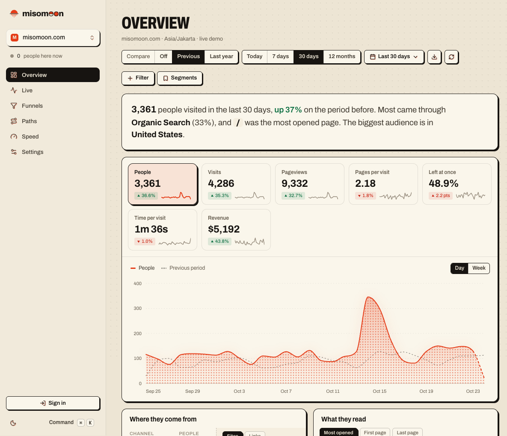
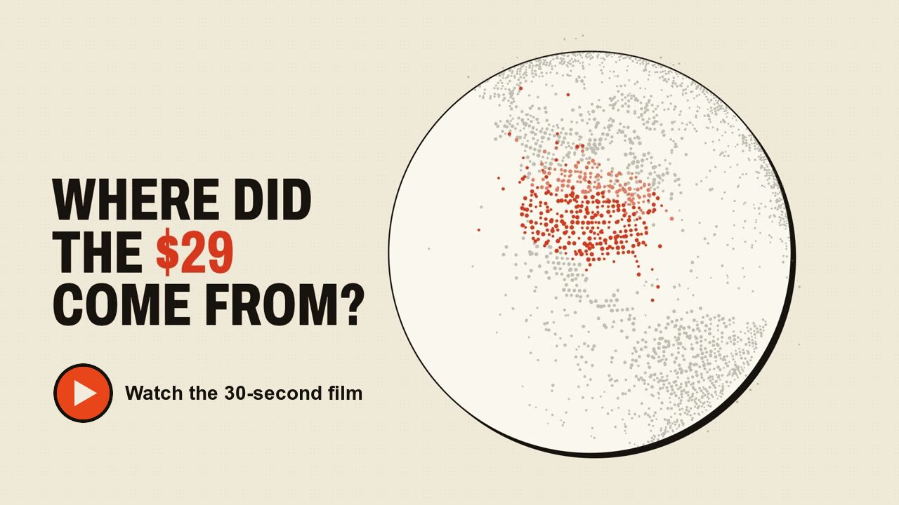
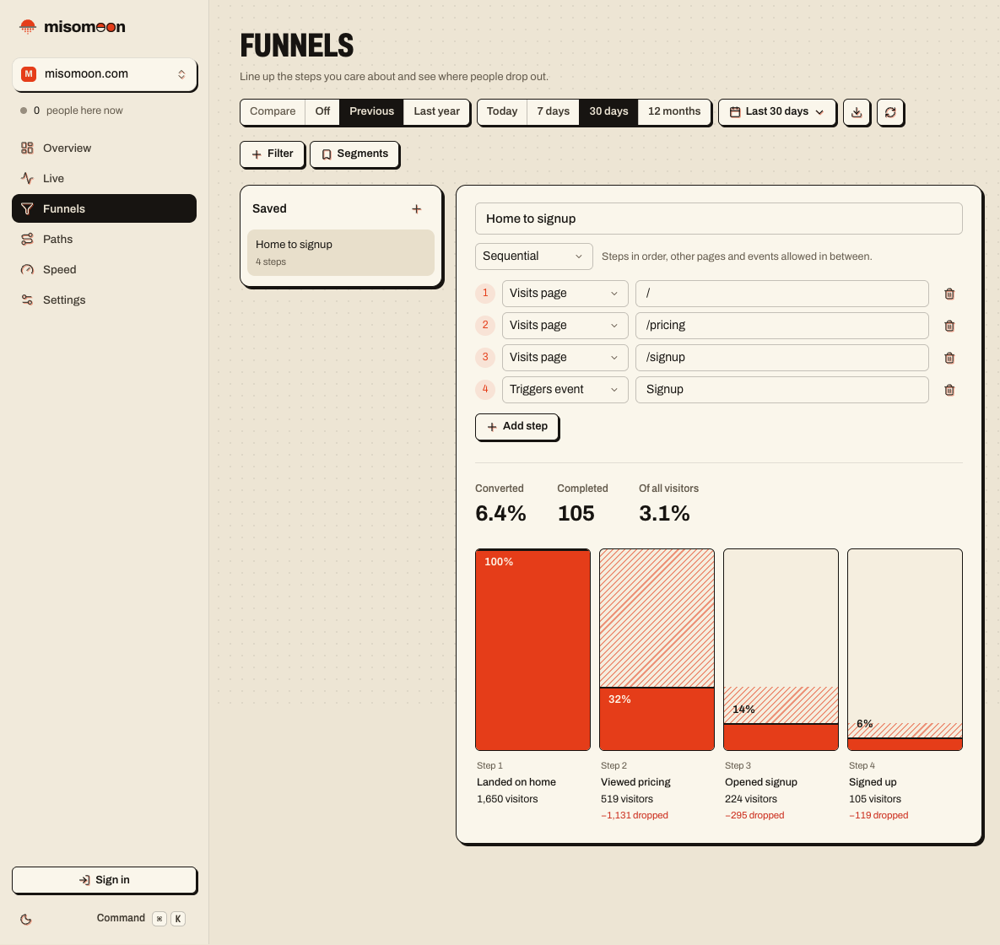
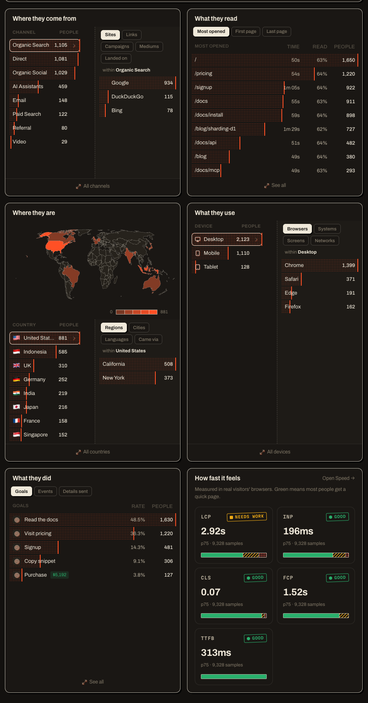

<p align="center">
  <picture>
    <source media="(prefers-color-scheme: dark)" srcset="docs/images/logo-dark.png">
    
  </picture>
</p>

<p align="center">
  Privacy-first web analytics that runs in your own Cloudflare account.<br>
  A Google Analytics alternative with no cookies, no servers, and an MCP server built in.
</p>

<p align="center">
  <a href="https://misomoon.com/demo">Live demo</a> ·
  <a href="docs/self-hosting.md">Deploy</a> ·
  <a href="docs/README.md">Docs</a> ·
  <a href="docs/comparison.md">Compare</a> ·
  <a href="CONTRIBUTING.md">Contribute</a>
</p>

<p align="center">
  <a href="https://github.com/jackzard/misomoon/actions/workflows/ci.yml"></a>
  <a href="LICENSE"></a>
</p>

<p align="center">
  <a href="https://deploy.workers.cloudflare.com/?url=https://github.com/jackzard/misomoon/tree/deploy/misomoon"></a>
</p>

misomoon is open-source web analytics that you deploy to your own Cloudflare account
with one button. It counts visitors without cookies and keeps every number in databases
that you own. Claude, Cursor, and other AI tools can read your stats through its
built-in MCP server. You have no server to run and nothing to patch.

<picture>
  <source media="(prefers-color-scheme: dark)" srcset="docs/images/overview-dark.png">
  
</picture>

A $29 payment lands the night a post goes viral. The 30-second film shows how misomoon
traces it back to the visit that brought the buyer.

<a href="https://misomoon.com/film/misomoon-film.mp4"></a>

## Set it up in about 5 minutes

You need a Cloudflare account and a GitHub or GitLab account. You don't need a server,
Docker, or a terminal.

1. Select **Deploy to Cloudflare**, and sign in to Cloudflare:

   [](https://deploy.workers.cloudflare.com/?url=https://github.com/jackzard/misomoon/tree/deploy/misomoon)

2. Connect your GitHub or GitLab account, and select **Create and deploy**. Cloudflare
   copies misomoon into a repository that you own, creates the databases and the
   queues, and deploys it.
3. Open your new URL, such as `https://misomoon.<your-subdomain>.workers.dev`, and
   create an account. The first account owns the instance. After it, sign-up closes,
   and people join by invitation.
4. In **Settings**, add your site's domain. Copy the snippet, and paste it into the
   `<head>` of every page:

   ```html
   <script defer src="https://misomoon.example.workers.dev/m.js?s=your-site"></script>
   ```

5. Open your site. Your visit appears in **Live** within a few seconds.

The [self-hosting guide](docs/self-hosting.md) covers each step in detail, plus a custom
domain, emails, and Google Analytics import.

### Deploy from the command line instead

```sh
git clone https://github.com/jackzard/misomoon.git
cd misomoon
pnpm install
pnpm --filter @misomoon/api exec wrangler login
pnpm --filter @misomoon/api run deploy
```

Only the first account can sign up, and everyone after it needs an invitation. The
[command-line steps](docs/self-hosting.md#deploy-from-the-command-line) explain what the
deploy creates.

## Why misomoon

- **Nothing to run.** misomoon is one Cloudflare Worker with D1 databases and a queue.
  Cloudflare runs it, so you have no server, container, or database to patch.
- **Your data stays in your account.** Every event lives in D1 databases that you
  control. Nobody else can read them, including the misomoon project.
- **No cookies.** The tracker stores nothing on the device and never stores IP
  addresses. Visitor ids come from a salt that changes every day, so nobody can follow a
  visitor from one day to the next, beyond a visit still open at midnight UTC.
- **One page answers most questions.** The overview shows sources, pages, countries,
  devices, goals, and Core Web Vitals together. Click any row to filter the whole page
  by it.
- **Your AI tools can read it.** The built-in [MCP server](docs/mcp.md) lets Claude,
  Cursor, and other clients answer "where did last week's signups come from?" from the
  same numbers that the dashboard shows.
- **Every feature is free.** Funnels, journeys, revenue, goals, email reports, alerts,
  and shared dashboards are all in the one version. There is no paid edition.
- **Bring your history.** Import your Google Analytics history or a CSV file, and
  connect Google Search Console to see what people searched for.
- **It grows with your traffic.** misomoon spreads events across D1 databases called
  shards. To add capacity, you change one number.

## What it costs

misomoon is free and MIT-licensed. You pay Cloudflare for what the Worker uses, and you
pay the misomoon project nothing.

The Workers Free plan handles about 3,000 events a day, which fits a personal site or a
small product. For more traffic, the Workers Paid plan starts at $5 a month for the
whole account. See [Workers pricing](https://developers.cloudflare.com/workers/platform/pricing/)
and [D1 pricing](https://developers.cloudflare.com/d1/platform/pricing/).

Self-hosting stays free. Each instance runs on its owner's Cloudflare bill, so no feature
sits behind a paid plan. [misomoon Cloud](docs/cloud.md), the hosted version, funds the
project, and it also has every feature on every plan.

## Pick a way to deploy

| | Deploy to Cloudflare button | Command line |
| --- | --- | --- |
| What you need | A browser, and a GitHub or GitLab account | Node.js 22.5 or later, pnpm 10, and git |
| Who can sign up | Only the first account | Only the first account |
| Shards | 2 | Any number, with `SHARD_COUNT`, and per data region with `SHARD_REGIONS` |
| Change the code | No. Your copy holds the built files. | Yes. Edit any package, and deploy. |
| Deploys run from | Cloudflare, on each push to your copy | Your machine, or your own CI |
| Upgrade | [Copy the new bundle](docs/upgrading.md#upgrade-a-deploy-to-cloudflare-install) into your repository | `git pull`, and deploy again |

Start with the button. Use the command line when you want to change the code, run more
than two shards, or deploy from your own CI.

## How it compares

| | misomoon | Google Analytics 4 | Plausible CE | Umami |
| --- | --- | --- | --- | --- |
| Open source | MIT | No | AGPL-3.0 | MIT |
| What you run | A Worker in your Cloudflare account | Nothing (Google runs it) | Docker, Postgres, and ClickHouse | Node.js and Postgres |
| Who holds the data | You | Google | You | You |
| Cookies | None | `_ga`, for 2 years | None | None |
| Funnels and revenue | Yes | Yes | Cloud Business plan only | Yes |
| Built-in MCP server | Yes | Experimental | Not in its docs | Yes |
| Tracker, gzipped | 987 bytes core, 1.9 KB Light, 4.8 KB everything | 157 KB | 1.3 KB basic, 2.5 KB current | 2.3 KB |

Checked on 2026-10-25.
[The full comparison](docs/comparison.md) covers DataFast, Mixpanel, Microsoft Clarity,
Matomo, PostHog, Fathom, Vercel Web Analytics, Simple Analytics, Pirsch, Cloudflare Web
Analytics, Swetrix, GoatCounter, and Rybbit, with a source for every cell.

## Track events and revenue

The snippet counts pageviews, including route changes in single-page apps. To count
signups, purchases, and other actions, call `misomoon()`:

```js
misomoon('Signup', { props: { plan: 'pro' } })
misomoon('Purchase', { revenue: { amount: 49, currency: 'USD' } })
```

The [tracking guide](docs/tracking.md) covers goals, hash routers, and how to exclude
your own visits. To credit payments to the visits that brought them, connect your
payment provider: [Connect payments](docs/revenue.md). For React Native and Expo apps, server-side events, and a typed wrapper
for React and Next.js, install `@misomoon/sdk` and read the [SDK guide](docs/sdk.md).

## Ask your AI tools

In **Settings**, open **Connect AI tools (MCP)**, and create a key for your site. Then
add the server to Claude Code:

```sh
claude mcp add --transport http misomoon https://analytics.example.com/mcp --header "Authorization: Bearer mm_..."
```

Ask Claude "Where did last week's visitors come from?" The
[MCP guide](docs/mcp.md) shows the setup for Claude Desktop, Cursor, and other clients.

## What's inside

<table>
  <tr>
    <td width="50%"></td>
    <td width="50%"></td>
  </tr>
</table>

- **Overview**: visitors, visits, pageviews, bounce rate, visit duration, and revenue,
  with comparisons to the previous period or the previous year.
- **Reports**: sources, UTM campaigns, pages, entry and exit pages, countries, regions,
  cities, browsers, devices, and custom properties. Click any row to filter.
- **Funnels and journeys**: up to 8 steps in strict, sequential, or flexible order, and
  the most common paths through your site.
- **Goals and revenue**: for events or page paths, with a reporting currency for each
  site.
- **Payments**: connect Stripe, Polar, Lemon Squeezy, Dodo Payments, or your own server,
  and see revenue by source, campaign, country, and device, without cookies.
- **Behavior**: clicks per element with rage and dead clicks, drawn over your live page;
  scroll depth; form fields people give up at; site search terms; JavaScript errors;
  video and audio plays; and impressions of tagged content. Counts only, no recordings.
- **Core Web Vitals**: LCP, INP, CLS, FCP, and TTFB from real visitors.
- **Realtime**: visitors in the last 5 minutes and a live event feed.
- **Sharing**: public dashboards, and shared links with a password and an expiry date.
- **Teams**: owners, admins, editors, and viewers, with invitations and API keys.
- **Email reports and alerts**: weekly and monthly reports with a PDF copy, and alerts
  for traffic spikes and drops.
- **Imports**: Google Analytics history, CSV files, and Google Search Console queries.
- **First-party proxy**: serve the tracker from your own domain, so ad blockers don't
  drop it.

## Limits

- misomoon needs Cloudflare. It doesn't run on your own hardware or in Docker.
- A visitor is unique for one day. The visitor id changes daily, so a returning visitor
  counts as new each day. This is what makes it work without cookies.
- Very large sites can outgrow the write rate of one D1 database for a single site. The
  [architecture notes](docs/ARCHITECTURE.md#sharding) describe the next step.

## Docs

- [Run misomoon in your Cloudflare account](docs/self-hosting.md)
- [Track your site](docs/tracking.md)
- [Track apps and servers with the SDK](docs/sdk.md)
- [Ask AI tools about your traffic](docs/mcp.md)
- [Serve the tracker from your own domain](docs/PROXY.md)
- [Track a WordPress site and WooCommerce store](docs/wordpress.md)
- [Configuration](docs/configuration.md) and [API](docs/api.md) references
- [Upgrade](docs/upgrading.md), [troubleshooting](docs/troubleshooting.md), and the
  [FAQ](docs/faq.md)
- [Architecture](docs/ARCHITECTURE.md)

## How it's built

misomoon is a pnpm monorepo. One Worker serves the tracker, the APIs, and the
dashboard.

| Path | Stack | What it does |
| --- | --- | --- |
| `apps/api` | Worker, Hono, D1, Queues | Ingest, the APIs, MCP, and cron jobs. Serves the dashboard. |
| `apps/dashboard` | Svelte 5, Vite+ | The dashboard |
| `apps/landing` | SvelteKit | The marketing site. You don't need it to run misomoon. |
| `apps/docs` | SvelteKit | The docs site, built from `docs/` |
| `packages/core` | TypeScript | The event schema, filters, SQL builders, the shard planner, and merges |
| `packages/tracker` | JavaScript | `m.js` |
| `packages/sdk` | TypeScript | `@misomoon/sdk`, for React, Next.js, React Native, and servers |
| `packages/brand` | CSS, SVG | Design tokens and the logo |
| `plugins/wordpress` | PHP | The WordPress plugin |
| `templates` | Workers, Vercel | One-click proxy templates |

## Feedback and contributing

Ask questions and share ideas in
[Discussions](https://github.com/jackzard/misomoon/discussions).
[Report a bug](https://github.com/jackzard/misomoon/issues/new/choose) in the issues.
[CONTRIBUTING.md](CONTRIBUTING.md) shows how to run misomoon locally with demo data. To
report a security issue, follow [SECURITY.md](SECURITY.md).

## License

[MIT](LICENSE).
